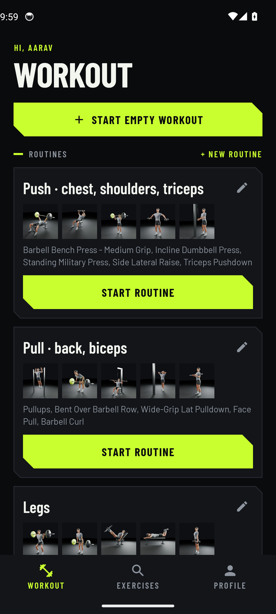
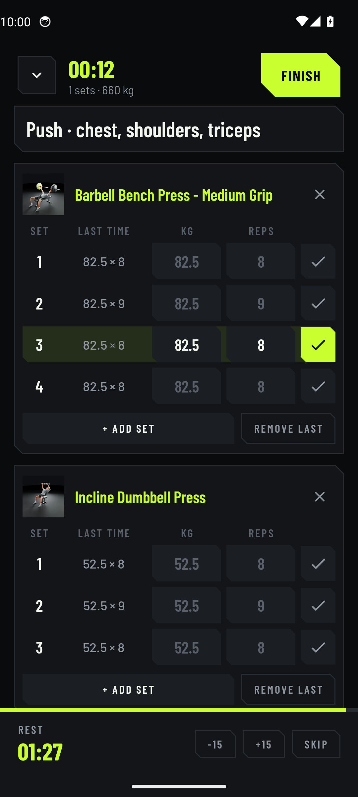
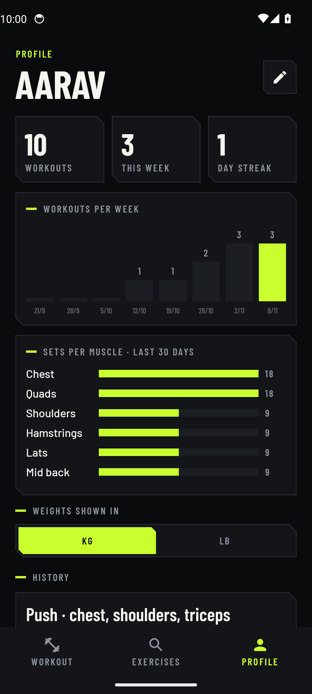
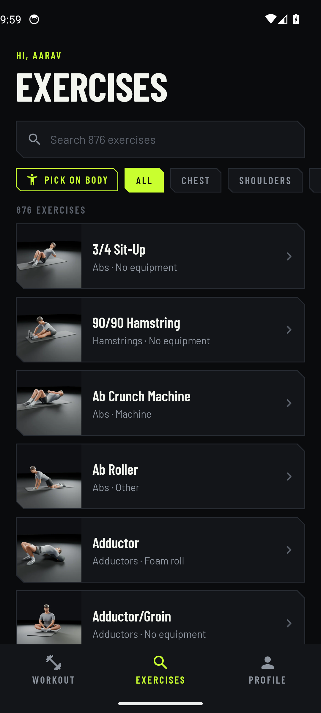

# Forge

A free Android workout tracker: build routines, log every set with last time's numbers beside it, rest timer, stats and history, and 876 exercises you can watch in 3D. No account, no limits; everything stays on your phone.

**[Download the latest APK](https://github.com/Dante3750/forge-gym/releases/latest)**

## Screens

Taken automatically on an Android emulator by CI after every build, using the latest 3D trainer renders.

| Workout | Logging a workout | Profile |
|:---:|:---:|:---:|
|  |  |  |
| **Exercises** | **Exercise** | **Turn & zoom in 3D** |
|  |  |  |

## What's inside

- **Routines:** save the exercises for each training day and start them with one tap. Four starter routines included.
- **Workout logging:** weight and reps per set, last time's numbers beside each set, warm-up sets, and a rest timer that starts when you tick a set.
- **Profile:** workouts per week, sets per muscle, streak, and your full history. Records and past sets on every exercise.
- **Exercises:** all 876 in one list with search, a muscle filter and a tap-a-muscle body picker.
- **3D trainer:** a realistic animated human for every movement, man or woman, slow motion and a second angle.
  Rendered from code in [forge-motion](https://github.com/Dante3750/forge-motion). Open any exercise in real-time 3D to turn and zoom.

## Build

Pushing to `main` builds the APK with GitHub Actions and publishes it as a release, then takes the screenshots above.
Kotlin, Jetpack Compose, no server and no paid APIs.

Exercise data: [free-exercise-db](https://github.com/yuhonas/free-exercise-db) (Unlicense).
