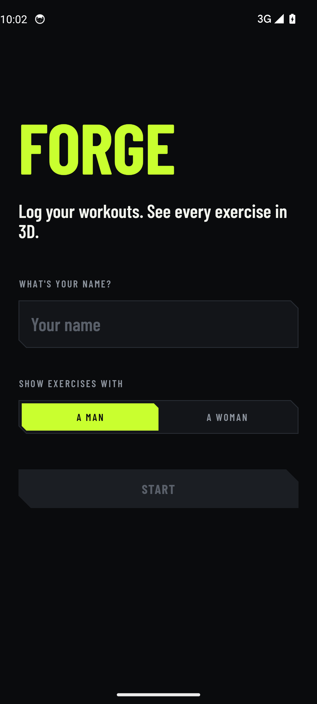
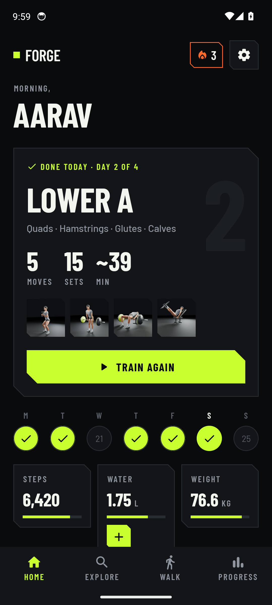
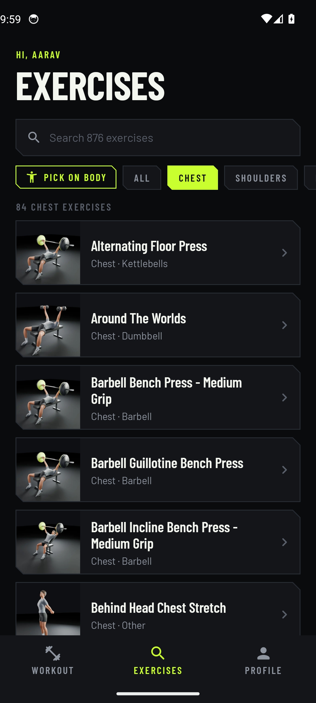
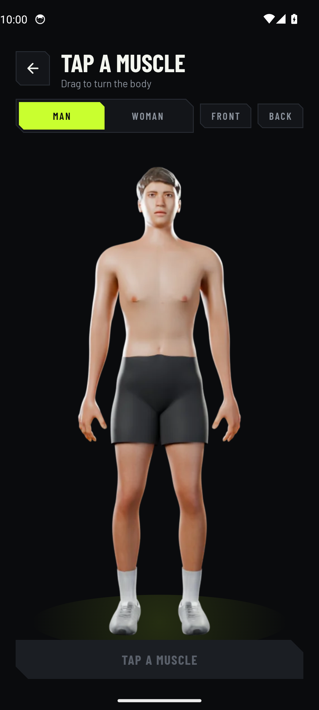
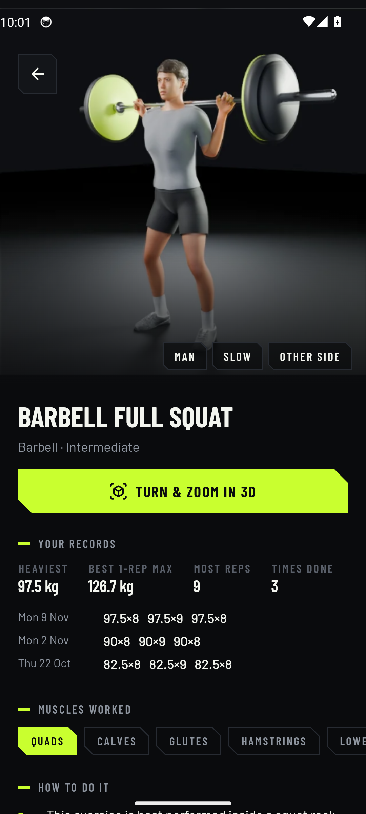
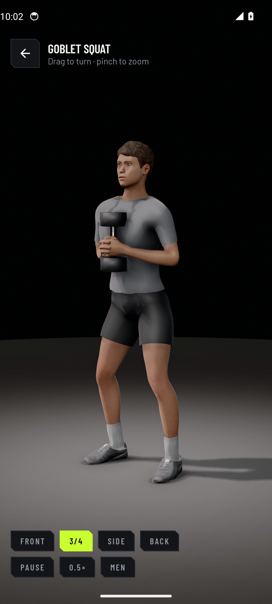

# Forge

A free, simple Android gym app: type your name, then browse 876 exercises and watch each one in 3D. Nothing else to set up.

**[Download the latest APK](https://github.com/Dante3750/forge-gym/releases/latest)**

## Screens

Taken automatically on an Android emulator by CI after every build, using the latest 3D trainer renders.

| Welcome | All exercises | Filter by muscle |
|:---:|:---:|:---:|
|  |  |  |
| **Pick a muscle on the body** | **Exercise** | **Turn & zoom in 3D** |
|  |  |  |

## What's inside

- **One screen:** every exercise in a single list with search and a muscle filter.
- **Pick on the body:** tap a muscle on a realistic turning body to see its exercises.
- **3D trainer:** a realistic animated human for every movement, man or woman, slow motion and a second angle.
  Rendered from code in [forge-motion](https://github.com/Dante3750/forge-motion).
- **Live 3D viewer:** open any exercise in real-time 3D, turn it around and pinch to zoom.

## Build

Pushing to `main` builds the APK with GitHub Actions and publishes it as a release, then takes the screenshots above.
Kotlin, Jetpack Compose, no server and no paid APIs.

Exercise data: [free-exercise-db](https://github.com/yuhonas/free-exercise-db) (Unlicense).
